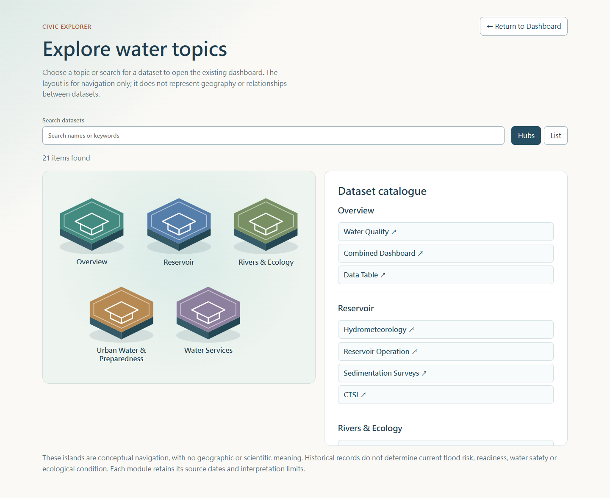

# Feitsui Civic Explorer delivery

Status: **PASS_WITH_LIMITATIONS** — optional navigation implemented; existing analytical scope retained. Delivery is one feature branch and one Draft PR, without automatic merge.

## Implementation and ownership

`src/navigation.ts` is the existing `MonitoringTab` / `NavigationCategory` catalogue moved unchanged out of `MonitoringTabs`. Both dashboard and Explorer derive their labels, category memberships and module targets from it. There is no second runtime tab list. The adapter derives searchable Chinese and English metadata, including module identifiers, without fetching data.

The five categories contain 3 / 4 / 6 / 5 / 3 modules, respectively: Overview, Reservoir, Rivers & Ecology, Urban Water & Preparedness, Water Services. All 21 existing targets are accessible through native HTML buttons in the scene's catalogue, explicit list view and chunk-failure fallback. SVG is decorative inside native category buttons. The Explorer retains the reference geometry, depth, shadows, inset outlines, muted category colors and reduced-motion behavior. Desktop uses a side panel; mobile stacks the hubs and complete catalogue.

The original dashboard remains the default. Explore Topics lives in the existing navigation, including both evidence-panel shells. Explorer has separate temporary category/query/view state. The dashboard subtree remains mounted under `hidden`, preserving its current tab, host filters and component-local state during a round trip. Module activation calls the existing host tab setter. Return restores entry focus; module navigation defers destination-heading focus until data loading completes. Escape restores selected-hub focus. An optional-chunk failure focuses a complete HTML fallback.

Existing initial `#preparedness` and `#river-policy` entry behavior is unchanged. Explorer does not introduce URL/history routing; module selection remains in memory, as in the original dashboard. Reload still uses the existing initial hash contract. There is no mandatory WebGL, Three.js, animation library, shared package or new dependency.

See [reuse and full MIT notice](civic-explorer-attribution.md). Reference repositories were read only.

## Verification

- Exact Git Bash `./init.sh`: **passed**, including `npm ci` (0 vulnerabilities), `npm run convert:data` using local files, 95 unit tests, TypeScript, production build and `GITHUB_PAGES=true npm run build`.
- The first sandboxed Bash attempt could not start. A later run encountered a Windows file lock from the local preview. Stopping previews and rerunning the exact harness resolved both; neither remains a blocked check.
- `npm test`: **95 passed** (92 existing analytical/data regressions plus three catalogue/search tests covering every target and label in both languages).
- `npm run test:browser`: 83 checks passed in local production Edge, Pages path, 320 / 390 / 768 / 1440px, both languages. Evidence is in [browser-results.json](evidence/civic-explorer/browser-results.json).
- Browser checks include every host module target, all five category mappings, bilingual search, category and module keyboard activation, focus entry/return/reset/Escape, cold evidence-to-legacy focus, reduced motion, empty results, list mode, optional chunk failure, preserved filters, direct entries, chart SVGs, data table rows, map visibility and zoom.
- River map expectations follow the existing coordinate file: the current empty river-location list must not produce inferred pins. Water-quality, pumping and sedimentation maps remain available under their original rules.
- `git diff --check`: **passed**. No separate lint script exists; `npm test` and builds run the supported TypeScript checks.
- Visual comparison against the Real Estate reference: **94/100**, desktop and mobile, with layout changes for the requested responsive detail panel. Verdict is also retained with the evidence.

The runner uses existing or bundled Playwright without changing dependencies. Example on a machine with Playwright available:

```powershell
$env:PLAYWRIGHT_MODULE_PATH = 'absolute/path/to/playwright'
npm.cmd run test:browser
```

It launches its own local Pages preview and a fresh headless Edge profile, blocks service workers, and stubs external map tile images. No Taipei Open Data acquisition is performed. Browser results retain exact checked bundle names, request lists and local timing samples. Baseline code was rebuilt from `beedd7e` in a temporary directory with the same dependencies and committed public assets.

## Bundle and loading measurements

Same Pages build mode, byte sizes (decimal kB):

| Asset | Baseline | Final | Difference |
| --- | ---: | ---: | ---: |
| Main JS | 1,059,956 bytes | 1,062,151 bytes | +2,195 bytes (0.21%) |
| Main JS gzip | 311,799 bytes | 312,687 bytes | +888 bytes |
| Optional Explorer JS | absent | 5,623 bytes / 2,612 gzip | loaded on entry |
| Optional Explorer CSS | absent | 5,605 bytes / 1,651 gzip | loaded on entry |

Cold application request counts remain **36** for default dashboard, **1** for preparedness, and **2** for river policy. Explorer JS is absent from initial requests. Opening Explorer adds **zero data requests** in each case. Baseline and final request details and single-run local timing samples are stored in [baseline-loading.json](evidence/civic-explorer/baseline-loading.json) and [browser-results.json](evidence/civic-explorer/browser-results.json); these timings are observations, not a repeatable performance benchmark. Baseline bundle sizes are in [baseline-bundles.json](evidence/civic-explorer/baseline-bundles.json).

## Data and scientific boundaries

No official snapshots, public data, conversion/validation, hydrometeorological calculations, reservoir/ecology calculations, water-quality interpretations, preparedness scenarios, river evidence rules, RPI gates, exports or source metadata are changed. Offline conversion was run only because the project harness requires it; generated outputs were restored before delivery. The browser regression runs against the committed static assets.

The islands are conceptual navigation elements. Visible bilingual copy explicitly excludes geographic/scientific relationships and inference of current flood risk, operational readiness, water safety or ecological condition. Each destination retains its existing source dates, scientific limitations and original analytical UI.

## Screenshots




## Known limitations

- The existing main bundle still exceeds Vite's 500 kB advisory threshold. This feature adds 0.21% main JS and keeps scene assets optional; broader analytical splitting is outside scope.
- The existing service worker independently pre-caches legacy data on installation. It is unchanged. Application-request isolation uses blocked service workers; this PR does not certify a full offline upgrade/caching lifecycle.
- Automated Edge checks cover browser accessibility semantics, focus, reduced motion and responsive widths. No physical mobile device, independent screen-reader audit, Safari/Firefox run or hosted performance benchmark is claimed.
- The complete HTML navigation fallback still requires the application's JavaScript runtime. It works without SVG interaction and survives failure of the optional Explorer chunk.
- Navigation continues to use the application's existing in-memory module state and initial supported hashes. This PR adds no per-module URL history.
