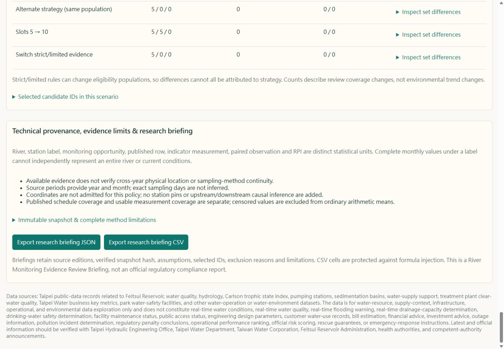
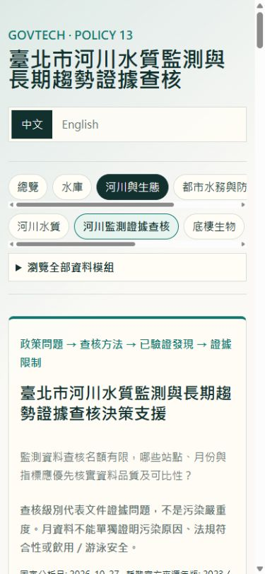

# Policy #13 delivery evidence

Fixed analysis date: **2026-10-27, Asia/Taipei**. This is the final planned policy initiative; Policy #14 was not started. No merge is authorized or performed.

## Requested delivery checklist

1. **Baseline SHA:** `94b460758bda198bd1b83a0e7839814a944898ec`, fetched from origin/main before editing. Baseline had 65 passing tests. No open PR was found at startup.
2. **Branch / PR:** `codex/river-water-longitudinal-policy-13`; PR link is recorded below after creation. Target is main; exactly one reviewable unmerged PR.
3. **Catalogue / resource identities:** dataset `759db528-77b5-4aa3-b6fa-2b857890214e`; independently derived annual IDs and official update times are in [source audit](river-water-policy-source-audit.md). 2023 `0e488a9c-7e44-4c30-bd07-049779218a76`; 2024 `44524259-d419-4c95-aa6f-16d58f03d1c1`; 2025 `4f2bf5d2-9561-471a-a53c-7da82dfac0e2`; 2026 `a66f7820-35c0-42f4-af31-87c2401f3c12`.
4. **Accepted editions:** ROC 112–115 / 2023–2026. Original Big5/CP950 CSVs and four independent contextual HTML resources retained. 2026 updated 2026-10-16 09:00:48; acquired 2026-10-27T00:13:36.437Z.
5. **Original hashes:** 2023 `6ccd7907164ab593ad60c123d764fb473420015f88afaeebb7d25459c1627fb6`; 2024 `e71033568e29b1cffbc0babefd94ca66f653effd1488611d0b34028e03f04907`; 2025 `b5114013df50d2e1fecb2ad446b8134c23858ad408af88f803a58d837664c8e3`; 2026 `39ca05ac221eab632fde2b5d2e359b633d5ffa5fcb2a7ed40a70c8d3b0177f34`. Hashes are over original bytes, with Git attributes preventing line-ending conversion.
6. **Historical comparison:** 2023–2025 unchanged. Historical 2026 was 17,651 bytes / 80 observed rows; accepted edition is 23,858 bytes / 144 observed rows. The old explorer retains its original inputs. Historical total was 656 measurement-bearing rows; accepted total is 720 (+64), although both publish 768 calendar rows.
7. **Published counts:** 192 rows per annual edition, 768 total; nine rivers and 16 river/station labels. No duplicate station-month identities or unparseable rows in this accepted edition.
8. **Observed counts:** 192 + 192 + 192 + 144 = 720 rows containing valid exact or censored measurements. All are partial across the full 27-field inventory because optional fields contain `---`; this does not mean every scheduled analyte failed or every sample is invalid.
9. **Future exclusions:** 32 entirely empty November–December 2026 rows are future placeholders. The 16 empty October rows are current-period pending publication, not overdue observations. No missing result becomes zero.
10. **Station identity:** 15 current official label matches, one unmatched label (`青礜溪` versus `菁礐溪`). No alias, relocation or historical physical continuity is invented. All 16 physical-continuity statuses remain unverified.
11. **Qualifiers / limits:** 20,736 published cells: 10,684 exact measured, 1,571 censored, 7,185 `---`, 1,296 blank, zero unparsed. Per-indicator numeric detection-limit histograms are in [results JSON](river-water-policy-results.json), e.g. NH3-N 0.02/0.07/0.08 mg/L and coliform <1/<10 CFU/100mL. Changing limits are retained rather than substituted or averaged as exact values.
12. **Coverage:** 768 published calendar opportunities, 736 opportunities through the cutoff month, 720 observed periods. The 16 opportunities without observations are the still-open October month. Excluding the current month leaves 720 earlier opportunities with 720 observed rows. Commissioning/discontinuation dates remain unknown. [Coverage methodology](river-water-policy-observation-coverage.md) separates denominators and indicator coverage.
13. **Longitudinal eligibility:** 1,296 investigated station × indicator × adjacent-year windows. Strict eligibility is zero. Limited same-label descriptive eligibility is 823 windows with 7,239 exact same-month indicator pairs; 473 windows lack supported limited evidence. Pairs are not independent samples and do not establish trends.
14. **Official RPI method:** DO, BOD5, SS and NH3-N in mg/L map to points 1/3/6/10, averaged over four constituents. [RPI methodology](river-water-policy-rpi-methodology.md) records official literal thresholds and boundary golden fixtures. Published table precision gaps, referenced reporting-digit/rounding rules and common-sampling evidence remain unresolved.
15. **RPI result:** 460 potential complete exact four-input rows; zero research RPI observations admitted; all 768 published rows excluded from RPI calculation. No fabricated RPI value, class or official-match claim.
16. **Mode A tiers:** 736 eligible candidates, A=46, B=690, C=0. Tiers describe documentary priorities, not environmental severity. The unmatched station accounts for the through-cutoff Tier A population.
17. **Mode B:** strict zero; limited 823 descriptive windows. The UI displays exact paired monthly differences, matched counts, exclusions and source lineage. Exports include paired and nonpaired published-cell qualifier distributions separately.
18. **Mode C:** unavailable. Monthly data lacks independent causal identification, historical station/method confirmation, applicable permit/standards and official compliance or public-health suitability evidence. It does not rank pollution sources.
19. **Capacity scenarios:** both strategies select 5 / 10 / 736 at capacity 5 / 10 / all. Selected tiers are 5/0/0, 10/0/0 and 46/690/0 respectively. All capacity covers nine rivers and 16 labels. Small capacities cover one river and one station because tier/issue precedence is preserved. No geographic diversity is forced over a primary identity question.
20. **Overlap / sensitivity:** default capacity-5 strategies share all five IDs, with zero added/removed. Restricting to 2026 changes the population to 160 (A10/B150), −576; capacity-5 comparison has zero shared, five added and five removed IDs. This is explicitly a population change, not a strategy effect or environmental improvement.
21. **Actual IDs:** default selected IDs are `A:station-b304f8239c8754ee:2023-01`, `...:2023-02`, `...:2023-03`, `...:2023-04`, `...:2023-05`; capacity 10 extends through October 2023. Full IDs for all six scenarios and exact added/removed sets are in results JSON and the immutable snapshot.
22. **Geography:** zero Policy #13 station pins admitted. The current official page contains location context, but no historical coordinate-to-row lineage has been accepted. Existing map contracts and coordinate files are preserved. [Geographic audit](river-water-policy-geographic-evidence.md).
23. **Snapshot integrity:** ID `sha256-212d8dfb4b965163b6ff0edbb87765e87d933eac994f8d120de9d7b15a29dc81`; exact-file SHA-256 `212d8dfb4b965163b6ff0edbb87765e87d933eac994f8d120de9d7b15a29dc81`. Immutable file under `public/data/river-water-policy/snapshots/`, validated atomic `current.json` pointer. Offline verification rebuilt twice and compared exact bytes, pointer, analysis and scenario IDs. Failed-source/build tests preserve accepted state.
24. **Architecture / files:** offline source fetch/audit, pure qualifier/eligibility/scenario utilities, static snapshot builder/verifier, lazy bilingual React panel, scoped CSS, safe export functions and focused tests. No new dependencies, backend, account, inferred coordinates or browser government API calls. Shared candidate IDs avoid repeating full candidate objects in each scenario. Existing heavy-rain code/data and research conclusions are unchanged. See the [implementation plan](river-water-policy-implementation-plan.md) and PR file list.
25. **JSON / CSV verification:** final GitHub Pages production-preview browser downloads exactly matched the offline representative files: default capacity5 JSON 76,875 bytes / CSV 118,004 bytes with the final snapshot hash. A filtered 2026 新店溪 scenario with10selected was also tested. Final offline all-capacity outputs: Mode A JSON 1,054,538 / CSV 2,455,649 bytes; limited B JSON 3,940,168 / CSV 6,299,507 bytes; empty C JSON 4,243 / CSV 2,895 bytes. All are below 12 MiB. Tests verify replay consistency, exact hash identity, CSV escaping/formula-prefix protection, empty output and deterministic ordering. Final representative files are under `docs/evidence/river-water-policy/briefing.*`.
26. **Tests / builds:** final full Git Bash `./init.sh` passed: npm ci, convert:data, 92 tests + TypeScript, ordinary and Pages builds. Scoped audit, exact rebuild verification and report generation passed. `git diff --check` passed. No lint script is defined; TypeScript and whitespace checks provide static checking. Existing large initial bundle warning remains. Full init's unrelated timestamp/path/line-ending/projection churn was restored; old generated datasets are absent from the final diff.
27. **Browser QA:** actual in-app browser testing in both languages at widths 320/390/768/1024/1440; no document horizontal overflow, all new tables have captions, all selects have labels and keyboard focus is visible. Verified source/year/river/station/indicator scope, 5/10/all, balanced selection, strict B=0, limited B=823, C unavailable, null-gap chart and no-exact-value state, downloads, missing-pointer error and restored retry. Existing river explorer, preparedness (228 inventory /36 candidates) and reservoir overview remained reachable. Final clean development and Pages production-preview tabs have zero console errors or warnings after initializing chart dimensions. Direct policy entry bypasses legacy fetch code; source inspection confirms policy fetches only its two local static URLs. No full browser network trace was captured.
28. **Performance:** final Pages main JS 1,059,956 bytes /311,799 gzip; lazy policy JS 57,635 /19,683 gzip; scoped CSS 2,208 /789 gzip. Snapshot 7,016,489 bytes /310,227 gzip. One Windows x64 Node v24.14.0 run: exact hash/content validation 125.76 ms; balanced capacity-10 pure calculation median 0.1885 ms /p95 0.2709 ms over 50 repetitions. These are local Node timings, not browser latency or portable benchmarks. Browser loading and retry states were observed; network latency/first-paint measurements were not claimed. [Machine-readable measurements](evidence/river-water-policy/performance.json).
29. **Outstanding limitations:** no historical physical continuity or commissioning dates; one unresolved alias; unknown sampling-method stability and exact sampling dates; no validated RPI rounding/common-event contract; limited descriptive pairs are not comparable trends; no causal/regulatory/public-health conclusion. Snapshot lineage is intentionally detailed; raw JSON is 7 MB. The existing initial bundle remains large. Policy-specific service-worker offline caching is not added.
30. **Portfolio Case Study 013:** use the source audit, accepted original hashes, historical-versus-current correction, pending/future distinction, station mismatch, 27-indicator qualifier audit, strict/limited gates, unavailable RPI/C decisions, actual deterministic IDs, reproducible snapshot, bilingual screenshots, safe downloads and measured build/runtime evidence. Portfolio publication/merge remains a separate human decision; do not start Policy #14.

## Visual evidence

The existing preparedness panel is the visual reference. Visual-verdict score **93/100, pass**, with responsive checks and final screenshots; the verdict is also persisted at `.omx/state/river-water-policy/ralph-progress.json` (local ignored runtime state).

Build/test logs, screenshots, representative exports and measurements are retained in `docs/evidence/river-water-policy/`.

## PR delivery status

Implementation commit `a939dc3` is pushed to `origin/codex/river-water-longitudinal-policy-13`. **No PR has been created and nothing has been merged.** The GitHub connector returned HTTP403 (`Resource not accessible by integration`). Automatic approval review then rejected a credential-helper fallback and normal-browser fallback as requiring explicit authorization after the connector failure. No credential access occurred and neither fallback executed. Await explicit authorization for using the user's already signed-in GitHub browser to create this exact PR, or create it manually from the comparison page below.

[Review changes and open the PR creation form](https://github.com/LEO0331/taipei-feitsui-water-map/compare/main...codex/river-water-longitudinal-policy-13?expand=1).

Title: **Add River Water Quality Monitoring & Longitudinal Evidence Review (Policy #13)**

Suggested body:

> Published annual station-month rows include empty calendar placeholders, so treating all768 rows as observations overstates coverage. This adds independently admitted original source bytes, explicit pending/future/observed states, an immutable verified snapshot, conservative comparability/RPI gates, deterministic5/10/all documentary review and a bilingual lazy dashboard at #river-policy.
>
> Accepted2023–2026 sources contain720 observed rows,16current-month pending rows and32future placeholders. ModeA736 eligible(A46/B690/C0); strict longitudinal comparisons/RPI remain unavailable with documented evidence blockers.823limited same-label windows contain7239exact monthly indicator pairs, explicitly descriptive. ModeC unavailable. Existing water/heavy-rain inputs and conclusions preserved; no backend or new dependencies.
>
> Full GitBash ./init.sh passed npmci, conversion,92tests+TypeScript and normal/Pages builds. Offline source audit and byte-identical repeated rebuild passed. Bothlanguages/fivewidths, selectors/scenarios, gates, keyboard focus, failure/retry, legacy navigation and production JSON/CSV downloads verified. Final downloads exactly matched offline briefings; clean console. Large initial bundle warning remains.
>
> See docs/river-water-policy-delivery.md and results.json for source IDs/hashes, all30 findings, actual selectedIDs, screenshots, performance and limitations. SnapshotSHA256212d8dfb4b965163b6ff0edbb87765e87d933eac994f8d120de9d7b15a29dc81. NoPolicy14; do not merge automatically.
